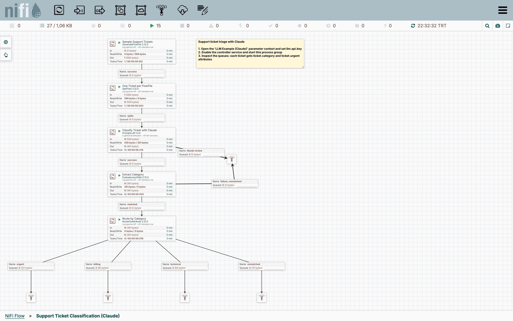
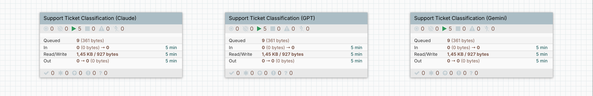
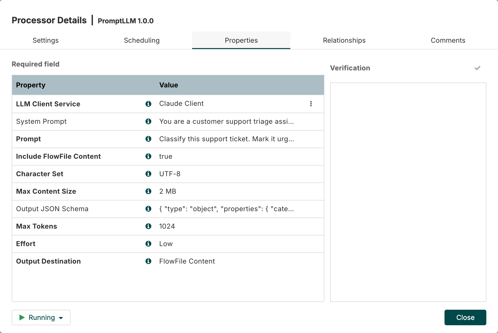
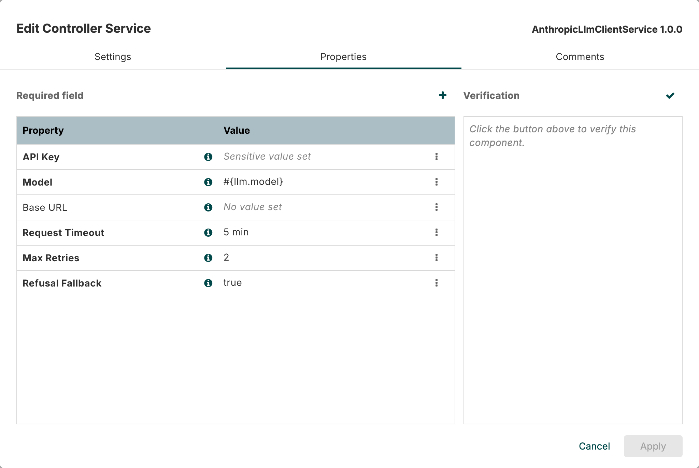

# NiFi LLM Processor

[English](README.md)

[Apache NiFi](https://nifi.apache.org) 2.x için büyük dil modeli processor'ı: **`PromptLLM`**. **Anthropic Claude**, **OpenAI GPT** ve **Google Gemini** için client servisleriyle birlikte gelir.

FlowFile içeriğini bir prompt ile birlikte modele gönderir, cevabı FlowFile içeriğine ya da bir attribute'a yazar. Sınıflandırma, veri çıkarma (extraction), özetleme, çeviri ve normalizasyon gibi işler için tasarlandı.



*[Örnek flow](#örnek-flowları-deneyin): Model her destek talebini sınıflandırıp yapılandırılmış JSON döndürür, NiFi de talebi kategorisine ve aciliyetine göre yönlendirir.*

> Bu bağımsız bir topluluk projesidir. Anthropic, OpenAI, Google veya Apache Software Foundation ile bağlantılı değildir; onlar tarafından desteklenmez ya da onaylanmamıştır.

Kafka için: [kafka-llm-processor](https://github.com/BuseKaylan/kafka-llm-processor).

## Yapı

```
PromptLLM processor  ──kullanır──▶  LLM Client Service
                                      ├── AnthropicLlmClientService   (Claude)
                                      ├── OpenAiLlmClientService      (GPT)
                                      └── GeminiLlmClientService      (Gemini)
```

- **Processor** işin kendisini tutar: prompt, JSON Schema, effort ve cevabın nereye yazılacağı.
- **Client service** bağlantıyı tutar: API anahtarı, model, base URL, timeout ve retry ayarları. Birden çok processor aynı servisi kullanabilir. Sağlayıcı değiştirmek için processor'ı başka bir servise bağlamak yeterli.
- **Her sağlayıcı ayrı bir NAR.** Sadece kullandığınız sağlayıcıyı kurarsınız; her biri o sağlayıcının resmi Java SDK'sını içerir.



## Özellikler

- **Her sağlayıcıda structured outputs:** `Output JSON Schema` verilirse cevap, şemaya uyan geçerli bir JSON olur.
- **Expression Language:** `Prompt` ve `System Prompt` alanları `${attribute}` ifadelerini destekler.
- **Üç relationship:** `success`, `refused` (model talebi reddetti) ve `failure`.
- **Yeniden deneme:** Rate limit, sunucu ve ağ hataları otomatik olarak yeniden denenir. Yine başarısız olursa FlowFile `llm.error.retryable=true` ile `failure`'a gider. Rate limit durumunda processor yield eder.
- **Verify desteği:** Her client service'teki *Verify* butonu API anahtarını ve modeli gerçek bir çağrıyla doğrular.
- **Boyut sınırı:** `Max Content Size` değerini aşan FlowFile'lar API'ye gönderilmeden `failure`'a gider. İçerik hiçbir zaman sessizce kırpılmaz.

## Kurulum

NAR dosyalarını [Releases](https://github.com/BuseKaylan/nifi-llm-processor/releases) sayfasından indirin ya da [kendiniz derleyin](#derleme). İki tanesi her zaman gerekli, diğerleri kullandığınız sağlayıcıya göre seçilir:

- `nifi-llm-api-nar` (zorunlu)
- `nifi-llm-processors-nar` (zorunlu)
- `nifi-llm-anthropic-nar`: Claude için
- `nifi-llm-openai-nar`: GPT için
- `nifi-llm-gemini-nar`: Gemini için

NiFi'nin `extensions` klasörüne kopyalayın:

```bash
cp nifi-llm-*-nar-1.0.0.nar $NIFI_HOME/extensions/
```

NiFi 2 yeni NAR dosyalarını yeniden başlatma gerektirmeden yükler. Yeni sürüm numaralı NAR'lara geçerken NiFi'yi yeniden başlatın.

**Uyumluluk:** Apache NiFi 2.12+ ve Java 21.

## Örnek flow'ları deneyin

[`examples`](examples) klasöründe her sağlayıcı için içe aktarılmaya hazır bir flow var: `support-ticket-classification-claude.json`, `-gpt.json` ve `-gemini.json`. Her biri dokuz örnek destek talebini ayırır, model her birini `billing`, `technical` veya `other` olarak sınıflandırıp acil olanları işaretler, NiFi de talepleri kategorisine göre yönlendirir.

1. NAR dosyalarını, sağlayıcınızınki dahil, kurun.
2. Üst araç çubuğundaki **Process Group** simgesini canvas'a sürükleyin, yükleme simgesine tıklayıp JSON dosyasını seçin.
3. Menüden (☰) **Parameter Contexts** → **LLM Example (…)** yolunu izleyin ve `llm.api.key` değerine API anahtarınızı girin. Farklı bir model kullanmak isterseniz `llm.model` değerini değiştirin.
4. Process group'a sağ tıklayıp **Enable All Controller Services** deyin, sonra yine sağ tıklayıp **Start** deyin.

## PromptLLM ayarları



- **LLM Client Service:** kullanılacak client service.
- **System Prompt**, **Prompt:** EL destekler.
- **Include FlowFile Content:** varsayılan `true`.
- **Character Set:** varsayılan `UTF-8`.
- **Max Content Size:** varsayılan `2 MB`.
- **Output JSON Schema:** isteğe bağlı. OpenAI strict modda çalışır; şemada `"additionalProperties": false` olmalı ve tüm alanlar `required` içinde yer almalı.
- **Max Tokens:** varsayılan `16000`.
- **Effort:** `Not Set` (varsayılan), `Low`, `Medium`, `High`, `Extra High`, `Max`. Claude'da `effort`, OpenAI'da `reasoning_effort`, Gemini'de `thinkingLevel` ayarına karşılık gelir.
- **Output Destination:** `flowfile-content` (varsayılan) veya `flowfile-attribute`.
- **Output Attribute Name:** varsayılan `llm.response`.

## Client service ayarları



Her servisin ayarları: **API Key**, **Model** (Anthropic için varsayılan `claude-opus-5-5`; OpenAI ve Gemini için zorunlu), **Base URL**, **Request Timeout** (varsayılan `5 min`), **Max Retries** (varsayılan `2`). Anthropic servisinde ayrıca **Refusal Fallback** (varsayılan `true`) bulunur.

## Yazılan attribute'lar

`llm.provider`, `llm.model`, `llm.stop.reason`, `llm.usage.input.tokens`, `llm.usage.output.tokens`, `llm.request.id`, `llm.refusal.reason`, `llm.error.message`, `llm.error.status`, `llm.error.retryable`, `mime.type`

## Derleme

```bash
mvn clean install
```

Testler, her sağlayıcının API formatını taklit eden yerel sahte sunucularla çalışır. API anahtarı gerektirmez, maliyet oluşturmaz.

## Lisans

[Apache License 2.0](LICENSE). Marka ve üçüncü taraf bildirimleri için [NOTICE](NOTICE) dosyasına bakın.
